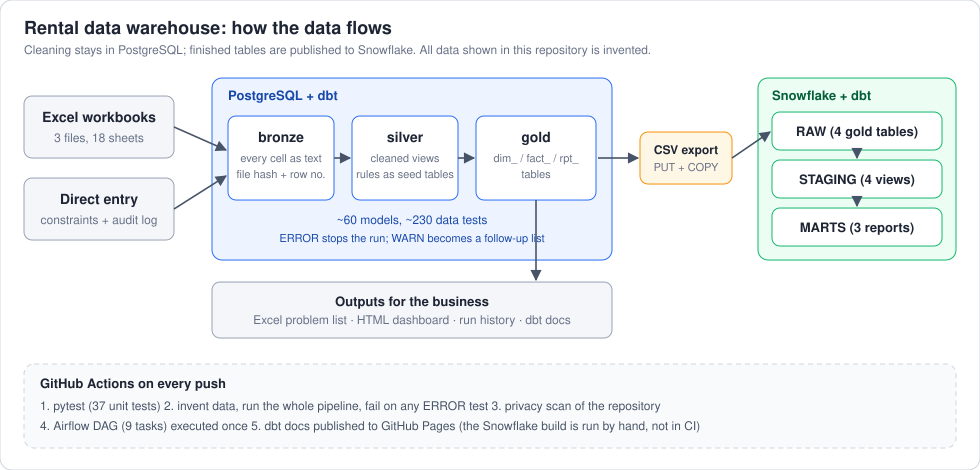
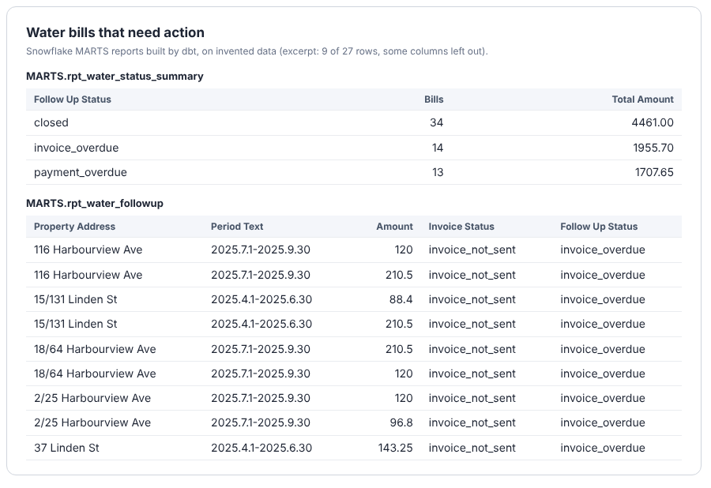

# Rental Data Warehouse (dbt + PostgreSQL)

[Live data docs](https://li-iris.github.io/rental-dwh-dbt/) · [Dashboard](https://li-iris.github.io/rental-dwh-dbt/dashboard.html) · CI runs on every push (synthetic data)

A small-business data warehouse rebuilt from three messy Excel workbooks (18 sheets) used by a rental agency to run
tenancies, rent collection, utility and water bills, inspections, parking and moving jobs.
**All data in this repository is invented.** The original project ran on a real agency's data, which never leaves the owner's computer.



## Run it in one command

```bash
docker compose up --build        # Postgres + the whole pipeline on invented data
# or, with Python 3.10 and a local Postgres:
pip install -r requirements.txt
export DBT_PROFILES_DIR=$PWD/dbt PGDATABASE=rental_dwh
make demo                        # invent data -> load -> dbt seed/run/test -> problem list -> history
make dashboard                   # docs_site/dashboard.html
```

CI (`.github/workflows/ci.yml`) does exactly this on every push and fails if any ERROR-level check fails.

## What is in it

| Area | What it shows |
|---|---|
| Ingestion | `scripts/01-02`: every cell loaded as text with file hash + row number; re-running never duplicates; a layout guard (`02b`) stops the load if someone inserts a column in Excel |
| Modelling | medallion layers; dimensional gold layer; ~60 dbt models, seeds for business rules, custom schema macro |
| Messy-data handling | free-text rents ("920, from 2.6 970"), dates without years ("6.18 Sam"), carried-down addresses, three lists side by side in one sheet - parsed in SQL, never guessed (a month.day cell with no year stays empty rather than getting an invented year) |
| Data quality | ~230 dbt tests: `assert_*` = must never fail (ERROR), `warn_*` = business follow-up (WARN). Failing rows are stored and exported as an Excel problem list with one sheet per issue |
| Business rules as data | `dbt/seeds/business_rules.csv`: due days, legal limits, thresholds - each with who decided it and why. Change a number, not SQL |
| Time-aware statuses | "overdue / expired / due soon" are judged against `gold.dim_report_date` (the day dbt runs, or `--vars report_date=...`), so a refresh recalculates everything |
| Direct entry | `entry` schema with constraints, foreign keys and an audit trigger (before/after JSON of every change); entry rows merge with Excel rows in staging |
| Operations | one-command refresh (`run_all.sh`), run history schema, backups, least-privilege roles, launchd scheduling |

Docs: [`docs/DATA_MODEL.md`](docs/DATA_MODEL.md), [`docs/ER.md`](docs/ER.md), [`docs/BUSINESS_RULES.md`](docs/BUSINESS_RULES.md),
[`docs/DATA_DICTIONARY.md`](docs/DATA_DICTIONARY.md), [`docs/OPERATIONS.md`](docs/OPERATIONS.md).

## Tests and orchestration

- `tests/` - 37 pytest unit tests for the extraction step, the loading helpers, the Excel layout guard, the dbt-summary parser and the cloud scripts (`make test`; also run in CI).
- `airflow/rental_dwh_dag.py` - the same refresh as `run_all.sh`, split into 9 tasks. The `airflow` job in CI installs Airflow 2.10 in its own environment, checks the task order and runs the whole DAG once on the synthetic data (`airflow dags test`). It is not deployed to a long-running scheduler.

## Cloud layer (Snowflake)

The heavy part - cleaning the Excel sheets - stays in PostgreSQL, where it is written in SQL with regular expressions and arrays.
The finished gold tables are then published to Snowflake, where dbt builds a few reports and checks on top:

```
PostgreSQL gold  ->  scripts/export_gold.py  ->  CSV files  ->  scripts/snowflake_load.py  ->  Snowflake RAW
                     (refuses to run on                          (PUT + COPY INTO,              |
                      non-synthetic data)                         row counts checked)           v
                                                              dbt_snowflake/: 4 staging views, 3 report tables, 14 data tests
```

```bash
PGDATABASE=demo_dwh python scripts/export_gold.py raw_private/gold_csv     # from the synthetic demo database
source ~/.snowflake/env.sh                                                 # account, user, key path - no secret in the repo
python scripts/snowflake_load.py raw_private/gold_csv
cd dbt_snowflake && dbt build --target snowflake
```

Login uses a key pair (a service user with a public key), so there is no password in any file. Settings come from environment variables (`dbt/profiles.yml`, target `snowflake`).
`scripts/s3_landing.py` uploads and downloads the CSV files to an S3 bucket (server-side encrypted); it is not part of the Snowflake path yet.

What the reports built in Snowflake look like (invented data, excerpt):



| Part | How it was checked |
|---|---|
| Report and test SQL | run against PostgreSQL with the synthetic data, then on a Snowflake trial account: `dbt build` = 21 of 21 passed |
| Export and load scripts | helper functions covered by pytest; the load itself was run by hand on a Snowflake trial account (4 tables, row counts matched) |
| S3 module | pytest with a fake S3 client only; not yet run against a real AWS account |
| Snowflake in CI | not done: it would need credentials stored as repository secrets |

## The synthetic data

`scripts/gen_synthetic.py` writes two workbooks with the same sheet titles and column positions as the originals,
with deliberate defects (overdue water bills, unclear rents, an expired parking contract, a property inspected five times in a year...).
Only 8 of the 18 sheets carry rows; the other 10 are header-only so the pipeline's table structure is complete.

## Honest limits

- Business rules (e.g. 90-day water recovery window, 21 days to pay, up to 4 routine inspections a year) follow NSW practice as understood by the author; this is not legal advice.
- Bank-transaction detail and rent arrears are not modelled.
- Only 4 gold tables are published to Snowflake and only 3 reports are built there; the Excel cleaning is not ported to Snowflake SQL.
- `docker compose up` is provided but has not been run by the author; CI is the tested path.
- The Snowflake and S3 parts have not been run in CI (see the table above).
