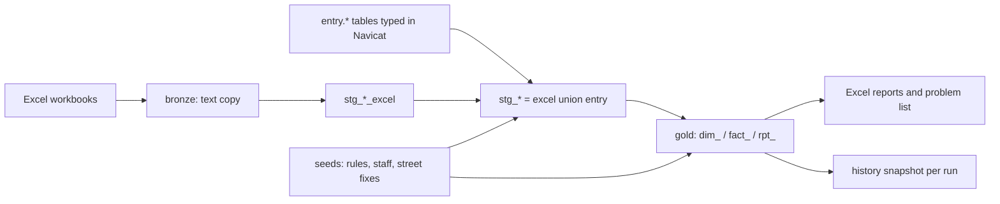

# Entity relationships

`dim_property` is the centre: every table that is about a property carries `property_id` (an md5 of `property_key`).

```mermaid
erDiagram
    dim_property ||--o{ dim_tenancy : "has leases"
    dim_property ||--o{ dim_room : "has rooms"
    dim_property ||--o{ fact_rent_roll_month : "rent per month"
    dim_property ||--o{ fact_rent_payment : "typed payments"
    dim_property ||--o{ fact_water_bill : "water bills"
    dim_property ||--o{ fact_utility_bill : "electricity and gas"
    dim_property ||--o{ fact_inspection_notice : "inspections"
    dim_property ||--o{ fact_special_term : "special clauses"
    dim_property ||--o{ fact_parking_lease : "parking"
    dim_property ||--o{ fact_moving_job : "moving jobs"
    dim_property ||--o{ fact_turnover_case : "move-outs and move-ins"
    dim_property ||--o{ fact_process_case : "paperwork cases"
    dim_property ||--o{ fact_rent_account_check : "rent account checks"
    dim_property ||--o{ fact_rmb_receipt : "RMB receipts"
    dim_property ||--o{ fact_rent_cash_receipt : "cash receipts"
    fact_moving_job ||--o{ fact_moving_job_item : "items"
    fact_turnover_case ||--o{ fact_turnover_step : "checklist grid"
    dim_turnover_step ||--o{ fact_turnover_step : "step definition"
    fact_turnover_case ||--o{ fact_turnover_tenancy_candidate : "possible leases"
    dim_tenancy ||--o{ fact_turnover_tenancy_candidate : "possible cases"
    fact_process_case ||--o{ fact_process_step : "checklist grid"
    dim_process_step ||--o{ fact_process_step : "step definition"
    fact_rent_roll_month ||--o| rpt_rent_received_month : "plus typed payments"
```

Typed-in data (schema `entry`) joins the same model in the silver layer:

